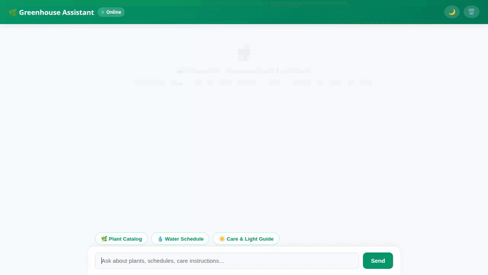

# Greenhouse Plant Care Agent 🪴

An intelligent, autonomous greenhouse assistant built using the **Google Agent Development Kit (ADK)**. This agent helps plant enthusiasts manage plant inventory, look up botanical taxonomy, track watering schedules, check live local gardening weather, execute python calculations, and generate AI plant images and videos.



---

## 🌟 Key Features & Capabilities

The agent is powered by **Gemini 2.5 Flash** and integrates directly with Google Cloud services:

* 🧠 **Cross-Session Long-Term Memory**: Uses **Vertex AI Memory Bank** to automatically retain user preferences, plant inventories, watering schedules, and plant health issues across separate sessions.
* 🗄️ **Firestore Plant Catalog**: Manages plant inventory records in Google Cloud Firestore with real-time tools to list, query, add, and update plant stock.
* 🖼️ **AI Image & Video Generation**: Generates plant visuals using `gemini-3.1-flash-lite-image` and `gemini-omni-flash-preview`. Artifacts are saved locally and uploaded directly to a **Public Cloud Storage Bucket**.
* 🎨 **A2UI Rich UI Cards**: Formats responses into interactive A2UI card schemas (`Card`, `Column`, `Row`, `Text`) for native rendering in dev UI and custom web frontends.
* 🐍 **Agent Engine Code Execution**: Executes Python code safely inside an **Agent Engine Sandbox** environment.
* 🌿 **Botanical & Weather Tools**:
  * **Live Weather & Gardening Conditions**: Checks real-time weather and calculates optimal watering recommendations.
  * **Botanical Taxonomy Lookup**: Fetches species details, family, and common names via Trefle API integration.
  * **Calculator & Time Utilities**: Performs arithmetic and checks current system timestamps.

---

## 🏗️ Architecture

```
                                  +-----------------------+
                                  | Cloud Run Chat UI     |
                                  | (FastAPI Proxy / A2A) |
                                  +-----------+-----------+
                                              |
                                              v
+-----------------------------------------------------------------------------------+
|                            ADK Greenhouse Agent                                   |
|                                                                                   |
|  +-----------------------+   +------------------------+   +--------------------+  |
|  | Vertex AI Memory Bank |   | Firestore Database     |   | Cloud Storage      |  |
|  | (Long-term Memory)    |   | (Plant Catalog)        |   | (Public Images)    |  |
|  +-----------------------+   +------------------------+   +--------------------+  |
|                                                                                   |
|  +-----------------------+   +------------------------+   +--------------------+  |
|  | Code Execution        |   | Gemini Image & Video   |   | Botanical Taxonomy |  |
|  | (Agent Engine Sandbox)|   | (Flash-Lite / Omni)    |   | (Trefle API)       |  |
|  +-----------------------+   +------------------------+   +--------------------+  |
+-----------------------------------------------------------------------------------+
```

---

## 🛠️ Project Structure

```
greenhouse-agent/
├── app/
│   ├── agent.py               # Root agent definition, system instructions, memory callbacks
│   ├── tools.py               # Firestore, GCS, Weather, Trefle, Image & Video generation tools
│   ├── a2ui_utils.py          # A2UI card formatting and callback handler
│   └── fast_api_app.py        # FastAPI server entrypoint
├── frontend/
│   ├── main.py                # Cloud Run FastAPI proxy (A2A protocol client)
│   └── static/
│       └── index.html         # Custom chat web frontend with built-in A2UI card renderer
├── agents-cli-manifest.yaml   # Agents CLI project manifest
├── deployment_metadata.json   # Agent Runtime deployment details
├── demo.gif                   # Demonstration recording
└── README.md                  # Project documentation
```

---

## 🚀 Getting Started

### Prerequisites
* Python 3.11+
* `uv` package manager (`pip install uv`)
* Google Cloud CLI (`gcloud`) authenticated to your GCP project

### 1. Local Setup
Clone the repository and install dependencies:
```bash
git clone <your-repo-url>
cd greenhouse-agent
uv sync
```

Set up environment variables:
```bash
export GOOGLE_CLOUD_PROJECT="your-gcp-project-id"
export GOOGLE_CLOUD_LOCATION="us-east1"
```

### 2. Run the Playground Locally
Start the local ADK Web playground with live agent reloading and Vertex AI Memory Bank support:
```bash
uv run adk web . --port 8080 --reload_agents --memory_service_uri=agentengine://<YOUR_MEMORY_BANK_ID>
```
Open your web browser and navigate to the port output in your terminal.

---

## 📦 Deployment

### Deploy Agent to Agent Runtime (Vertex AI)
Deploy the agent container to Vertex AI Agent Runtime:
```bash
agents-cli deploy --no-confirm-project
```

### Deploy Frontend to Cloud Run
Deploy the FastAPI A2A proxy and chat UI to Cloud Run:
```bash
gcloud run deploy greenhouse-frontend \
  --source frontend/ \
  --region us-east1 \
  --allow-unauthenticated \
  --set-env-vars AGENT_ENGINE_RESOURCE_NAME="<YOUR_AGENT_ENGINE_RESOURCE_NAME>",AGENT_DIRECTORY="app"
```
